<p align="center">
  
</p>

<p align="center">
  
</p>

<p align="center">
  <a href="https://www.linkedin.com/in/asaber01/"></a>
  <a href="mailto:Ahmedsaber0@outlook.com"></a>
  <a href="https://xgarage.org"></a>
  <a href="https://xflower.app"></a>
  
</p>

---

## 👋 About Me

I'm a **Frontend Engineer** with **3+ years** of experience building production web applications with **React, Next.js and TypeScript**. I focus on clean component architecture, performance and accessibility, and I ship bilingual **Arabic (RTL) / English** products.

- ⚡ **Performance-minded:** code splitting, lazy loading, image optimization and Core Web Vitals.
- 🧩 **Component systems:** reusable, typed components shared across products, built from Figma.
- 🔌 **Data & APIs:** REST integration with TanStack Query, Axios and Zod validation, plus auth and role-based permissions.
- 🤖 **AI-assisted workflow:** I use Claude and Claude Code for scaffolding, refactoring, debugging and tests, and I review and understand every change I ship.
- 📈 **Business background:** years in business development before engineering, so I build with users and outcomes in mind.
- 🌱 **Currently learning:** Node.js & Express backend development.

```ts
const ahmed = {
  role: "Frontend Engineer",
  experience: "3+ years",
  location: "Cairo, Egypt",
  core: ["React", "Next.js (App Router)", "TypeScript", "JavaScript (ES6+)"],
  strengths: ["Performance", "Accessibility", "RTL / i18n", "Design systems"],
  languages: ["Arabic (native)", "English (upper-intermediate)"],
};
```

---

## 🛠️ Tech Stack

**Core**

<p>
  
</p>

**Styling & UI**

<p>
  
</p>

**State, Data & Backend**

<p>
  
</p>

**Tooling & Quality**

<p>
  
</p>

**Also worked with**

<p>
  
</p>

<p>
  
  
  
  
  
  
  
  
</p>

---

## 🚀 Featured Projects

<table>
  <tr>
    <td width="50%" valign="top">
      <h3>🚗 X-Garage</h3>
      <p><b>Multi-tenant SaaS ERP for car workshops</b></p>
      <p>Bilingual (Arabic RTL / English) ERP covering job orders, invoicing, inventory, customers, vehicles, payroll and financials.</p>
      <ul>
        <li>150+ granular role-based permissions, multi-branch</li>
        <li>44-model database with per-tenant data isolation</li>
        <li>Super-admin console for managing tenants</li>
        <li>Automated tests, VPS deployment (Nginx, PM2, CI/CD)</li>
      </ul>
      <p>
        
        
        
        
        
      </p>
      <a href="https://xgarage.org"><b>🔗 xgarage.org</b></a>
    </td>
    <td width="50%" valign="top">
      <h3>🌸 X-Flower</h3>
      <p><b>Multi-tenant online catalog SaaS for flower shops</b></p>
      <p>Every shop gets its own bilingual catalog on a dedicated link, an easy admin dashboard, and orders straight to WhatsApp — no app to install.</p>
      <ul>
        <li>Per-shop catalogs, contacts and admin on one platform</li>
        <li>Smart bouquet pricing: change one flower's price and every bouquet using it updates automatically</li>
        <li>Arabic / English content, theming and branding per shop</li>
        <li>Mobile-first catalog with WhatsApp & call ordering</li>
      </ul>
      <p>
        
        
        
        
      </p>
      <a href="https://xflower.app"><b>🔗 xflower.app</b></a> · <i>Live</i>
    </td>
  </tr>
</table>

> Most of my professional work lives in private repositories, so contributions are shown without the source code.

---

## 🎓 Certifications

| Certification | Issuer | Status |
|---|---|:-:|
| CS50's Introduction to Computer Science | Harvard University (edX) | ✅ 2018 |
| Responsive Web Design | freeCodeCamp | ✅ 2025 |
| Full Stack Web Development (MERN) | ITI curriculum · self-paced | ✅ 2025 |
| Claude 101 | Anthropic Academy | ⏳ In progress |
| Claude for Engineering | Anthropic | ⏳ In progress |
| Back End Development and APIs (Node.js) | freeCodeCamp | ⏳ In progress |

---

## 📊 GitHub Stats

<p align="center">
  
  
</p>
<p align="center">
  
</p>
<p align="center">
  
</p>

---

<p align="center">
  <b>Open to collaborating on SaaS, dashboards and product-focused frontend work.</b><br/>
  <a href="https://www.linkedin.com/in/asaber01/">LinkedIn</a> · <a href="mailto:Ahmedsaber0@outlook.com">Email</a>
</p>
